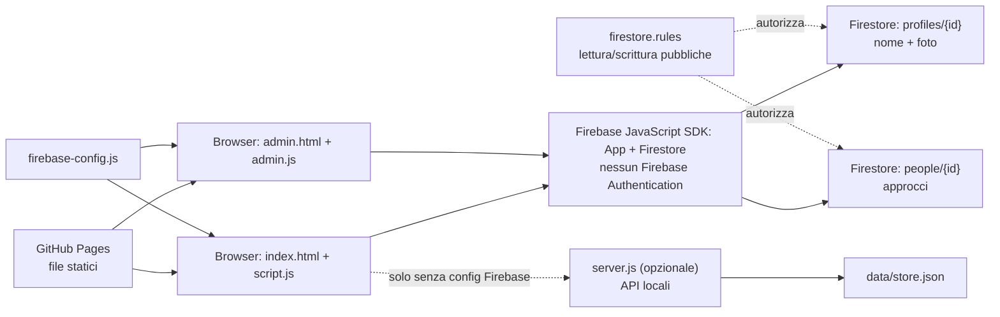

# Mappa del progetto Sfida

## Flusso dei dati

## File principali

| File | Responsabilità |
|---|---|
| `index.html`, `style.css` | Interfaccia pubblica e layout |
| `script.js` | Profili, foto, approcci, modifiche nell’interfaccia, sincronizzazione Firestore e classifica |
| `firebase-config.js` | Identificativi pubblici dell’app Firebase |
| `firestore.rules` | Regole Firestore per le raccolte `profiles` e `people` |
| `admin.html`, `admin.css`, `admin.js` | Consultazione e cancellazione dei documenti; pagina senza login |
| `server.js` | Server Node e API legacy locali |
| `data/store.json` | Archivio usato dalle API legacy locali, non da Firestore |
| `README.md` | Configurazione, pubblicazione e avvertenze |

## Limiti di sicurezza

Il browser contatta Firestore direttamente. Le regole consentono a chiunque di leggere, creare, modificare ed eliminare documenti in `profiles` e `people`; i controlli presenti nell’interfaccia sono solo di comodità e possono essere aggirati. Chiunque può anche inviare dati arbitrari e consumare la quota del progetto. Le foto vengono memorizzate nel documento profilo come stringhe data URL, non in Firebase Storage. La pagina admin non ha privilegi diversi dal resto del sito.
