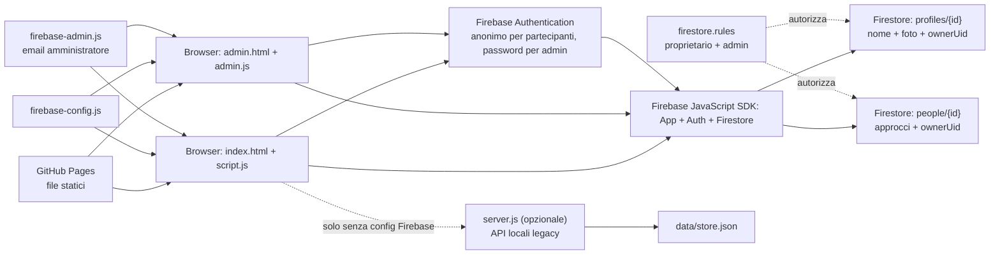

# Mappa del progetto Sfida

## Flusso dei dati

## File principali

| File | Responsabilità |
|---|---|
| `index.html`, `style.css` | Interfaccia pubblica e layout |
| `script.js` | Profili, foto, approcci, modifiche, sincronizzazione Firestore e classifica |
| `firebase-config.js` | Identificativi pubblici dell'app Firebase |
| `firebase-admin.js` | Email dell'account admin usata dal client; non contiene password |
| `firestore.rules` | Autorizzazioni e validazione documenti Firestore |
| `admin.html`, `admin.css`, `admin.js` | Login admin, consultazione live e cancellazione documenti |
| `server.js` | Server Node e API legacy locali |
| `data/store.json` | Archivio delle API legacy locali, non di Firestore |
| `README.md` | Configurazione, autorizzazioni e pubblicazione |

## Accessi e autorizzazioni

I partecipanti accedono con Firebase Authentication anonima. Profili e approcci memorizzano `ownerUid`; le regole permettono a ciascun partecipante di creare e modificare soltanto i propri documenti. Gli utenti autenticati possono leggere i dati condivisi necessari alla classifica. Le cancellazioni sono riservate all'account password `marreio296@gmail.com`.

Le foto sono salvate nei documenti profilo come stringhe data URL; non è configurato Firebase Storage. La password non è presente nei file del progetto. Pubblicare `firestore.rules` sul repository non aggiorna le regole attive: vanno pubblicate anche dalla Console Firebase.
